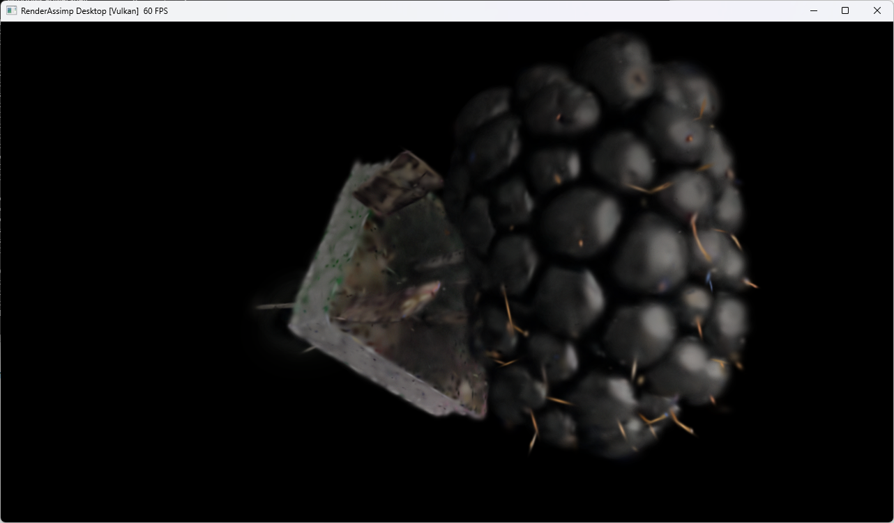

# Colab gsplat compilation investigation (2026-10-29)

## Result

The restricted gsplat 1.6.0 extension built and loaded successfully in
**313.2 seconds (5 min 13 s)**. The unrestricted build had spent over an
hour compiling unused kernel variants before failing. CUDA 13.4 was retained;
compiler optimization levels were not reduced.

The separate GPU forward/backward check passed. The dataset smoke run then
**completed all 500 steps**, reporting 496.0 seconds at the final step and
successfully exporting a PLY plus checkpoint. A user-provided screenshot shows
the result displayed in RenderAssimp Desktop (Vulkan).
Full training, refinement, and MCMC were not yet verified at the time of this
report.

## Environment

| Component | Observed configuration |
|-----------|------------------------|
| GPU | Tesla T4, compute capability 7.5, 15 GiB VRAM |
| Driver | 580.82.07; `nvidia-smi` reports CUDA compatibility 13.0 |
| Host compiler | Ubuntu GCC/G++ 13.3.0 |
| Notebook kernel | Python 3.13.16 |
| Isolated training interpreter | Python 3.12.9 |
| PyTorch | 2.15.0+cu134 |
| nvcc | 13.4.92 |
| Compiler packages | `nvidia-cuda-nvcc`, `nvidia-cuda-crt`, `nvidia-nvvm`: 13.4.92 |
| CCCL | `nvidia-cuda-cccl==13.3.4.3.1` |
| Runtime package set | `cuda-toolkit[cudart]==13.4.1`, as required by PyTorch |
| gsplat | 1.6.0, `8c33ba2aa4b1283376b679af397ee373d1f4c80e` |
| Ninja jobs | 10 |
| GPU target | Only `sm_75`, not multiple architectures |

`nvidia-smi`'s CUDA compatibility field is not the installed nvcc version.
Actual CUDA computation, extension loading, and backward execution were tested
rather than inferring compatibility from that field.

## Failure sequence and corrections

1. **Unrestricted compilation took over an hour.** A completed 3DGUT parallel
   forward compilation appeared at 4033 seconds of elapsed Ninja build time.
   Another run completed a 3DGUT serial forward file at 3128 seconds.
   These timestamps are cumulative build times, not individual file durations.
   Ninja prints completed commands, so long gaps alone did not establish a hang.

2. **The original PR source failed in host C++ compilation.**
   [nerfstudio-project/gsplat#1085](https://github.com/nerfstudio-project/gsplat/pull/1085),
   pinned at `2a29ad06ba008bb34c9b942e82c2d46d39a194f4`, replaces
   `std::isfinite` with `::isfinite` to address Windows device compilation.
   Colab's host compiler instead failed in `Cameras.cuh` with
   `::isfinite has not been declared`. More waiting could not fix that error;
   already-running compiler jobs continued before Ninja finally exited.

3. **Switched to the host/device-aware implementation from**
   [nerfstudio-project/gsplat#1055](https://github.com/nerfstudio-project/gsplat/pull/1055).
   Its `gsplat_isfinite()` helper uses `__finitef` for device compilation and
   `std::isfinite` for the host pass. An initial transcription mistakenly
   omitted the last `e` of the commit SHA, causing pip's Git checkout to fail.
   The corrected full 40-character SHA is installed from the PR author's
   `kyo-zzz/gsplat` fork.

4. **Fixed conflicting toolkit package requirements.** Installing the
   `cuda-toolkit==13.4.3` metapackage replaced runtime packages that PyTorch
   requires at toolkit version 13.4.1. Later dependency resolution reversed
   that replacement. The installer now pins nvcc/CRT/NVVM and CCCL separately,
   retaining PyTorch's required runtime package set and applying constraints.

5. **Disabled unused kernel families and channel specializations.**
   The current trainer renders ordinary RGB 3DGS, with `with_ut=False` and
   `with_eval3d=False` through gsplat's defaults. Its child environment now sets:

   ```text
   BUILD_2DGS=0
   BUILD_3DGUT=0
   NUM_CHANNELS=3
   ```

   The unrestricted configuration includes 23 channel alternatives. A logged
   3DGUT dispatch combines those with two tile sizes and three boolean
   parameters: up to 368 combinations at that dispatch site. Restricting
   features avoids generating code the current training path never executes.

   gsplat still submits the source files to Ninja: `51` build steps does not
   mean the disabled kernels are compiled. Preprocessor gates remove their
   implementation. The formerly expensive serial 3DGUT file completed by
   approximately 2.5 seconds of the restricted build.

6. **Exposed CCCL headers to the host compiler.** The next attempt failed after
   241 seconds with `fatal error: cuda/std/limits: No such file or directory`
   while compiling `Rendering.cpp`. The headers were installed, but their
   directory was absent from the host include search. The runtime now prepends
   the toolkit's `include/cccl` to `CPATH`, preserving existing entries.
   Retrying then successfully built and loaded the extension.

## Memory and compiler activity

During the long build, an `atop` snapshot showed:

- 51.0 GiB reported RAM, 38.5 GiB available;
- two `cicc` processes each using approximately one full CPU core;
- zero memory PSI pressure and zero OOM kills in the displayed interval;
- negligible I/O wait and no swap activity.

This indicated active compilation, not a memory-pressure stall. Container limits
can differ from host-level totals; the snapshot does not establish that no
earlier memory event ever occurred.

The successful run reported Python peak RSS of **601.0 MiB** and largest reaped
child peak RSS of **2150.9 MiB**. These are **not combined process-tree peaks**.

## Validation and timing limits

Successful build output:

```text
gsplat: CUDA extension has been set up successfully in 310.94 seconds.
PASS: gsplat build/load
Build/load elapsed: 313.2 s
```

The successful log ran through the 51-step build. Earlier attempts, package
downloads, and filesystem caches mean this was not a controlled cold-cache
benchmark against an otherwise identical unrestricted build.

The subsequent 32x32 single-Gaussian GPU check reported:

```text
ninja: no work to do.
PASS: gsplat forward/backward | peak GPU MiB: 0.1
```

It checked output shapes, finite RGB/alpha, a visible Gaussian, and finite
gradients for means, quaternions, scales, opacity, and colors. It does not by
itself validate all optional gsplat features.

### Completed dataset smoke run

The user supplied the complete successful log after the initial report.
The run reused the compiled extension (`ninja: no work to do.`) and used:

```text
engines_cuda/run_train.py --smoke \
  --data /content/drive/MyDrive/blackberry-splats/dataset \
  --out /content/drive/MyDrive/blackberry-splats/cuda_out_stable/smoke \
  --data-factor 4 --strategy default
```

| Measurement | Result |
|-------------|--------|
| Views | 81 training, 12 test |
| Steps | 500/500, normal completion |
| Reported elapsed time at step 500 | 496.0 s (8 min 16 s), before final export |
| Average training-loop throughput | Approximately 1.01 steps/s |
| Image loading | Cache off; one image loaded from disk per step |
| Initial and final Gaussian count | 38,288 |
| Active SH degree throughout logged run | 0 |
| Loss, first / last step | 0.2386 / 0.0859 |
| Final L1 / SSIM loss / alpha loss | 0.0664 / 0.1343 / 0.0360 |
| Export | `splat_00500.ply` plus checkpoint in the smoke output directory |

Final log excerpt:

```text
step=499/500 loss=0.0758 l1=0.0508 ssim=0.1432 alpha=0.0409 n=38288 sh=0 (495.0s)
step=500/500 loss=0.0859 l1=0.0664 ssim=0.1343 alpha=0.0360 n=38288 sh=0 (496.0s)
  saved /content/drive/MyDrive/blackberry-splats/cuda_out_stable/smoke/splat_00500.ply + checkpoint
Training finished. Results in /content/drive/MyDrive/blackberry-splats/cuda_out_stable/smoke
```

No error or NaN was reported. Loss varies between sampled views; first/last
losses are not a controlled quality comparison. The `ssim` log field is the
loss term, not a standalone image-quality SSIM score. The unchanged Gaussian
count and SH degree mean this smoke run does not establish refinement or
higher-order SH behavior. It also does not test resume, MCMC, or the full
training schedule.

User-provided visual result after the smoke run:



The screenshot shows a recognizable blackberry on a black background, still
soft with visible stray splats after this short run. It is a visual sanity
check, not evidence of final reconstruction quality, color-space accuracy,
or numerical equivalence between viewers.

## What remains available, and what is restricted

- Ordinary RGB 3DGS, SH colors, alpha, and backward remain available.
- Adam, relocation/MCMC, and loss modules were not disabled.
- Standard strategy refinement and antialiasing were not disabled by these
  flags, but had not been individually validated by the reported GPU check.
- 2DGS, 3DGUT, and non-RGB channel specializations are intentionally unavailable.
- RGB means three channels, not a linear-light or gamma setting. No color
  space conversion was introduced.
- The unmodified gsplat `examples/simple_viewer.py` requests `RGB+D` at startup,
  requiring four channels. Its depth modes need additional channel support.
  A future viewer-capable build could use `NUM_CHANNELS=1,3,4` while still
  disabling 2DGS/3DGUT; that configuration was not built or tested here.

`MAX_JOBS=10` and existing optimization settings were preserved. No
`--Ofast-compile`, reduced optimization level, or split-compilation override
was introduced.

## Upstream evidence: not a proven CUDA 12.1-to-12.8 regression

[nerfstudio-project/gsplat#1001](https://github.com/nerfstudio-project/gsplat/issues/1001)
reports builds exceeding three hours. Comments mention the same world-space
parallel backward source, over-30-minute builds with CUDA 12.8/MSVC and a single
target architecture, and growing template-instantiation cost.

[nerfstudio-project/gsplat#1021](https://github.com/nerfstudio-project/gsplat/pull/1021)
includes an upstream compile-time reduction by removing an unused template
parameter.

These reports and our successful restricted build support reducing unnecessary
instantiations. They do **not** isolate a compiler regression between CUDA 12.1
and 12.8: gsplat sources, toolchains, and configurations differed.

NVIDIA documents profiling with `--fdevice-time-trace`, optimization-pass
parallelism with `--split-compile`, and compile-speed/runtime-performance
tradeoffs with `--Ofast-compile`. See the
[NVCC manual](https://docs.nvidia.com/cuda/cuda-compiler-driver-nvcc/index.html)
and [compile-time profiling guide](https://developer.nvidia.com/blog/optimizing-compile-times-for-cuda-c/).
These are possible investigation tools, not measured fixes from this run.

## Reproducing and preserving the working setup

The authoritative configuration is [runtime.py](runtime.py), loaded independently
by the notebook's diagnostic and training cells.

1. Run section 1 to update the checkout.
2. Run section 2 if packages are missing or the pinned installation changed.
3. Run 2a, 2b, and 2c to check basic CUDA, build/load, and GPU backward.
4. Mount Drive, complete the dataset smoke run, then start full training.

The restricted extension cache is:

```text
/content/torch_extensions/cu134-8c33ba2aa4b1283376b679af397ee373d1f4c80e-rgb3dgs-sm75
```

It is separate from the unrestricted build cache. Do not delete caches or locks
while a build is active. Restarted kernels on the same VM can reuse the cache;
a replacement VM loses `/content`.

Relevant branch commits:

| Commit | Change |
|--------|--------|
| `9ee59ee` | Initial PR #1055 switch; contained the truncated SHA |
| `49f72b7` | Correct full SHA/fork and separate compiler/runtime package pins |
| `b1a10b1` | Disable 2DGS/3DGUT, RGB-only specialization, isolated cache |
| `3758e72` | Add CCCL include directory to host compiler search |
